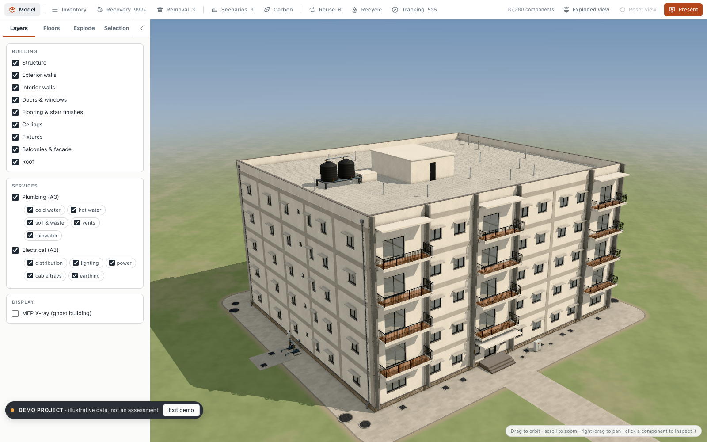
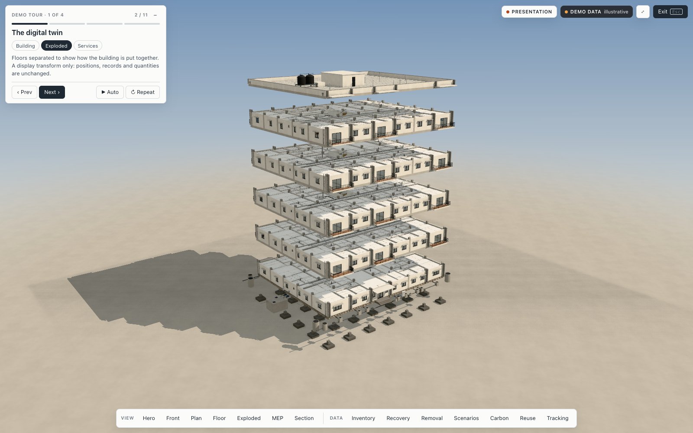
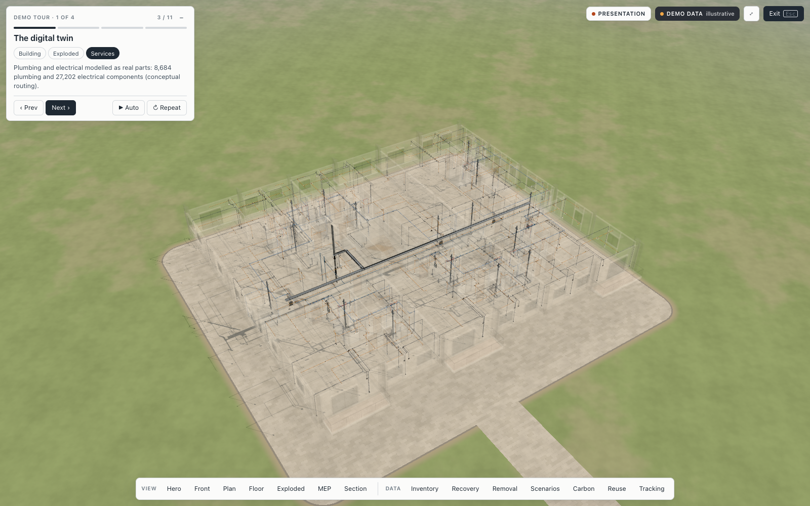
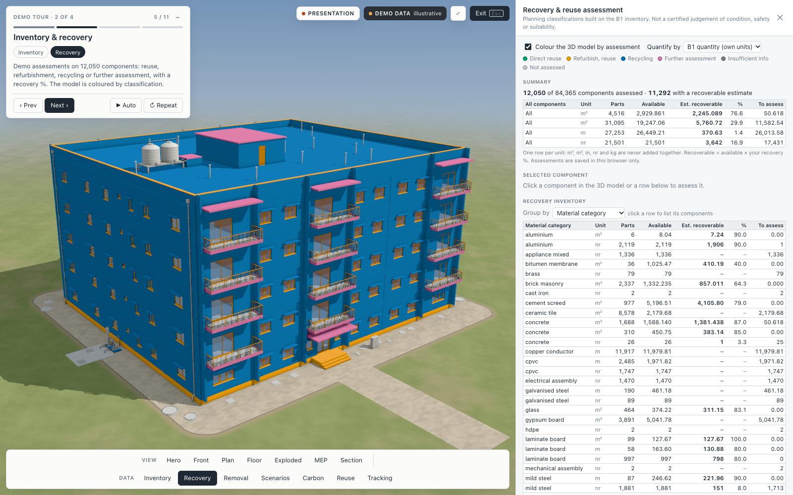
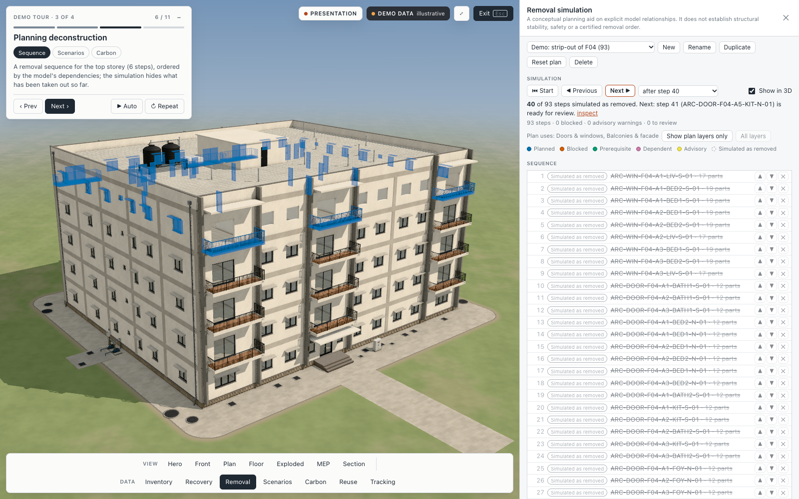
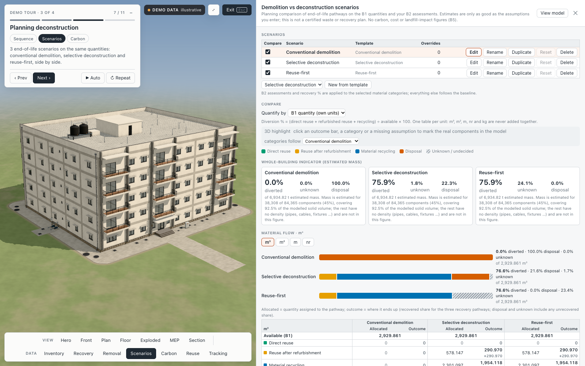
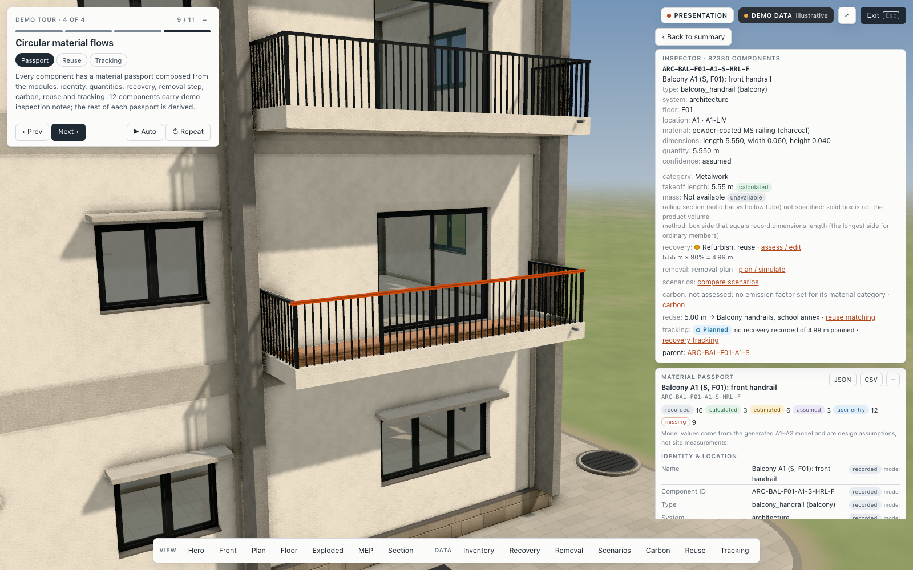
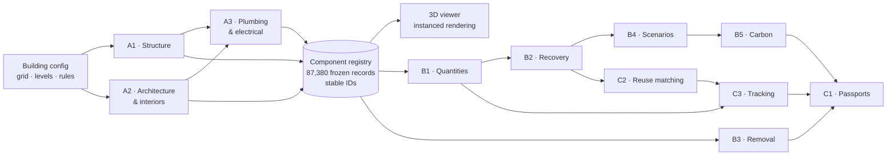

<div align="center">

# ♻️ ReLoop India

### A 3D digital twin for planning how a building comes apart — and where its materials go next.

Explore a fully modelled five-storey (G+4) residential block, down to individual tiles, pipes and cable runs.
Then assess what can be reused, sequence the removal, compare demolition with deconstruction,
and track every recovered component to its next home. It all runs in your browser.

**[▶ Open the live demo](https://kishoreraj2312.github.io/reloop-india/)** &nbsp;·&nbsp;
[Quick start](#-quick-start) &nbsp;·&nbsp;
[Features](#-what-you-can-do) &nbsp;·&nbsp;
[How it works](#-how-it-works) &nbsp;·&nbsp;
[Docs](#-documentation)

[](https://kishoreraj2312.github.io/reloop-india/)
[](https://github.com/Kishoreraj2312/reloop-india/actions/workflows/ci.yml)
[](LICENSE)




</div>

---

## Why this exists

Most buildings are knocked down as one heap of mixed waste. That isn't because nothing in them is reusable. It's because
nobody knows, component by component, what is inside them before demolition starts.

ReLoop India makes those contents visible first. Every one of the model's **87,380 components** has a stable ID,
real geometry, a material and a quantity. Every figure in the app — tonnes, recovery rates, carbon, diversion — is
computed from that model, with deterministic code and a label saying how each value was obtained.

It is built for **students, researchers, architects and engineers** working on circular construction, and for anyone
who wants a substantial, well-tested **React Three Fiber** codebase to learn from.

## ✨ What you can do

| | Module | What it does |
|---|---|---|
| 🏢 | **Digital twin** | Structure, walls, doors, windows, finishes, kitchens, bathrooms, balconies and roof, plus 8,684 plumbing and 27,202 electrical parts. Orbit around it, isolate floors, cut sections, or X-ray the services. |
| 💥 | **Exploded view** | Pull floors, systems and assemblies apart to show how the building is put together. It is a display transform only, so records and quantities never change. |
| 📏 | **Quantity takeoff** | Volumes, areas, lengths, counts and mass taken off the geometry itself, broken down by material, floor and system. Searchable table and CSV export. |
| ♻️ | **Recovery assessment** | Classify components as *direct reuse*, *refurbish & reuse*, *recycle* or *further assessment*, give each a recovery %, and colour the 3D model by the result. |
| 🧩 | **Removal simulation** | Build removal plans ordered by the model's dependencies, then step through them in 3D as parts disappear. |
| ⚖️ | **Scenario planning** | Compare conventional demolition, selective deconstruction and reuse-first on the same quantities, side by side. |
| 🌱 | **Embodied carbon** | Carbon per scenario from an editable, clearly labelled factor set. |
| 🪪 | **Material passports** | One passport per component, assembled from every module, with JSON and CSV export. |
| 🔁 | **Reuse matching** | Match recovered components to the requirements of receiving projects and allocate them. |
| 📦 | **Recovery tracking** | Follow each component from *planned* to *recovered*, *inspected*, *allocated*, and finally *reused* or *recycled*. |
| ♲ | **Recycle guide** | Material-by-material recycling guidance, with the model's own counts and tonnages. |
| 🎤 | **Presentation mode** | A guided 10-minute tour with one cinematic scene per module, ready for a talk or a classroom. |

## 📸 Screenshots

<table>
  <tr>
    <td width="50%"><br><b>Exploded view</b>: floors separated, data unchanged</td>
    <td width="50%"><br><b>Services X-ray</b>: pipes, conduits and cables as real parts</td>
  </tr>
  <tr>
    <td><br><b>Recovery assessment</b>: the model coloured by classification</td>
    <td><br><b>Removal simulation</b>: a 93-step plan, ordered by dependencies</td>
  </tr>
  <tr>
    <td><br><b>Scenarios</b>: demolition vs deconstruction vs reuse-first</td>
    <td><br><b>Material passport</b>: one component, seen through every module</td>
  </tr>
</table>

## 🚀 Quick start

**No install:** open the **[live demo](https://kishoreraj2312.github.io/reloop-india/)** in a desktop browser.

**Run it locally** (needs [Node.js](https://nodejs.org/) 20 or newer):

```bash
git clone https://github.com/Kishoreraj2312/reloop-india.git
cd reloop-india
npm install
npm run dev
```

Then open **http://localhost:5173**.

The first time the app opens with nothing entered, it loads an **illustrative demo project** by itself, so every module
has something to show. A *DEMO PROJECT* badge stays on screen while it is loaded, and **Exit demo** puts your own
project back exactly as it was. Everything you enter is saved in your browser's `localStorage`: there is no server,
no account and no tracking.

### Getting around

| Action | How |
|---|---|
| Orbit / zoom / pan | Drag · scroll · right-drag |
| Inspect a component | Click it in the 3D view |
| Open a module | Tabs along the top bar (Inventory, Recovery, Removal, Scenarios, Carbon, Reuse, Recycle, Tracking) |
| Layers, floors, exploded view | Left sidebar |
| Guided tour | **Present** → *Start 10-minute demo tour*, then **→ / ←** to move, **F** for full screen, **Esc** to leave |
| Force or skip the demo | Add `?demo=1` or `?demo=0` to the URL |

## 🧠 How it works

The whole building is **generated in code from one configuration**: grid, storey heights, wall build-ups, apartment layouts,
fixture rules and service routing. The same generator produces the geometry you see and the records the engines compute
with, so the picture and the numbers cannot drift apart.



**Design rules the code sticks to:**

1. **One stable ID per component.** `ARC-BAL-F01-A1-S-HRL-F` (a balcony handrail on the first floor) is the same in the
   3D view, inspector, inventory, passport and every CSV export.
2. **Geometry and data come from the same generator.** No totals are typed in by hand.
3. **All arithmetic is deterministic TypeScript.** Nothing is estimated by an AI model.
4. **Every value says where it came from:** *recorded*, *calculated*, *estimated*, *assumed*, *user entry* or *missing*.
   Units are never silently added together (m³, m², m, nr and kg stay in separate rows).
5. **The baseline is immutable.** Scenarios, plans and assessments are overlays on it.
6. **Per-component identity always survives rendering.** Thousands of parts are drawn as instanced batches, yet every
   instance still maps back to its own record, so anything you can see, you can click.

Rendering uses React Three Fiber with instancing, a ground-truth ambient occlusion pass (GTAO), clip planes for sections
and a site model, which keeps 87k components interactive in a normal browser.

## 🗂️ Project structure

```
src/
├── building/         configuration, IDs, registry and the pure generators
│   ├── structure/      A1: footings, columns, beams, slabs, stairs
│   ├── architecture/   A2: plan, walls, openings, facade, roof, interiors, kitchens, bathrooms
│   └── mep/            A3: drainage, rainwater, water supply, electrical distribution
├── engine/           deterministic engines: quantities, recovery, removal, scenarios,
│                     carbon, passport, reuse, tracking, explode
├── scene/            React Three Fiber viewer, 3D overlays and each module's workspace
├── ui/shell/         dashboard shell: top bar, sidebar, viewport and resizable dock
└── demo/             illustrative demo project and the 10-minute tour
scripts/
├── browser/          end-to-end checks that drive the real app in headless Chrome
└── plans, removal, explode, demo, b1   reports and drawings run with vite-node
docs/                 specifications, decisions, one write-up per module, screenshots
```

## 🧪 Quality

- **777 unit tests** (Vitest) cover the generators (plan tiling, overlaps, opening fit, MEP connectivity and drainage
  falls), quantity reconciliation, and every engine.
- **15 browser checks** drive the real app in headless Chrome over the DevTools Protocol, with no extra dependencies,
  asserting on what is actually rendered and saving screenshots to `docs/screenshots/`.
- **CI** type-checks, tests and builds every push and pull request, then deploys `main` to the live demo.

| Command | What it does |
|---|---|
| `npm run dev` | Start the dev server on port 5173 |
| `npm run build` | Type-check and build into `dist/` |
| `npm run preview` | Serve the production build |
| `npm test` | Run the unit tests |
| `npm run typecheck` | TypeScript only |
| `npm run verify:browser` | Browser check for the structure. `verify:browser:<module>` checks one module (`a2`–`a5`, `b1`–`b5`, `c1`–`c3`, `demo`, `starter`). Needs `npm run dev` running; set `CHROME_PATH` if Chrome is not in the default macOS location |
| `npm run plans` | Draw the ground and typical floor plans into `docs/plans/*.svg` |

## 📚 Documentation

| Topic | Document |
|---|---|
| Overview and principles | [PROJECT_OVERVIEW](docs/PROJECT_OVERVIEW.md) · [SYSTEM_ARCHITECTURE](docs/SYSTEM_ARCHITECTURE.md) · [DECISIONS_AND_ASSUMPTIONS](docs/DECISIONS_AND_ASSUMPTIONS.md) · [EXECUTION_ROADMAP](docs/EXECUTION_ROADMAP.md) |
| The building | [BUILDING_SPECIFICATION](docs/BUILDING_SPECIFICATION.md) · [ARCHITECTURE_LAYOUT](docs/ARCHITECTURE_LAYOUT.md) · [MEP_LAYOUT](docs/MEP_LAYOUT.md) · [COMPONENT_DATA_MODEL](docs/COMPONENT_DATA_MODEL.md) |
| Engineering modules | [QUANTITY_ENGINE](docs/QUANTITY_ENGINE.md) · [RECOVERY_ASSESSMENT](docs/RECOVERY_ASSESSMENT.md) · [REMOVAL_SIMULATION](docs/REMOVAL_SIMULATION.md) · [SCENARIO_PLANNING](docs/SCENARIO_PLANNING.md) · [CARBON_ASSESSMENT](docs/CARBON_ASSESSMENT.md) |
| Circularity modules | [MATERIAL_PASSPORTS](docs/MATERIAL_PASSPORTS.md) · [MATERIAL_REUSE_MATCHING](docs/MATERIAL_REUSE_MATCHING.md) · [RECOVERY_TRACKING](docs/RECOVERY_TRACKING.md) |
| Visuals and presenting | [EXPLODED_VIEW](docs/EXPLODED_VIEW.md) · [PRESENTATION_AND_VISUALS](docs/PRESENTATION_AND_VISUALS.md) · [DEMO_PROJECT](docs/DEMO_PROJECT.md) |

## ⚠️ What this is — and isn't

ReLoop India is a **planning and teaching tool**. Please read its results in that light:

- The building is a **parametric model** of a typical Indian G+4 residential block, built from design assumptions.
  It is not a survey of a real building.
- Plumbing and electrical routing is **conceptual**.
- The bundled carbon factors are **illustrative placeholders without a source**, and are labelled that way in the app.
  Replace them with sourced factors before drawing conclusions.
- Removal plans follow the model's relationships. They **do not establish structural stability or a safe demolition
  sequence**, and recovery classifications are not reuse certification.
- Data is stored in your browser (about 5 MB of `localStorage`). There is no multi-user backend yet.

## 🛣️ Ideas and contributions welcome

Good places to start:

- **Sourced carbon data:** plug in a published factor set, such as ICE or India-specific EPDs.
- **Bring your own building:** import IFC/BIM models alongside the parametric generator.
- **Cost estimates:** add economic figures to the scenarios (not built yet).
- **Faster first load:** code-split the 2 MB bundle.
- **Sharing:** export and import a whole project, or sync it to a backend.
- **More typologies:** add other building types through the configuration.

**To contribute:** fork the repo, create a branch, make sure `npm run typecheck` and `npm test` pass (and the matching
`verify:browser:*` check for UI changes), then open a pull request. For anything large, please open an issue first so
we can agree on the approach. One house rule: **no number without a label saying where it came from.**

## 📄 License

[MIT](LICENSE). You are free to use, modify and build on this project, including commercially.

<div align="center">

**If ReLoop India is useful for your research, teaching or project, please ⭐ star the repo. It helps others find it.**

</div>
