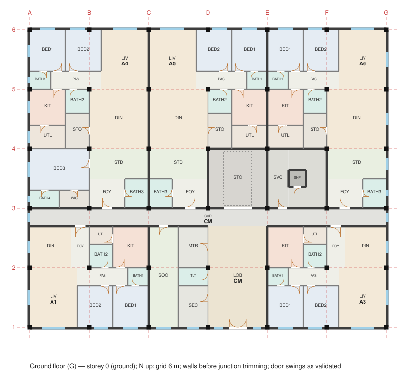
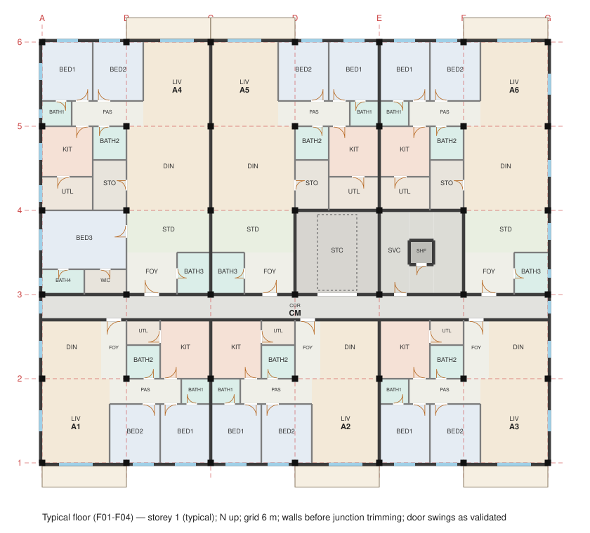

# ReLoop India — Architecture Layout (A2)

Conceptual layout for a recovery-planning digital twin. Nothing here claims code compliance, egress or fire
safety, structural adequacy or MEP coordination. Clearances are planning assumptions (listed below).

**Source of truth:** `src/building/architecture/layout.ts` (rooms, doors, windows, open boundaries, balconies) and
`src/building/architecture/config.ts` (conventions). The plans below are generated from the same model by
`npm run plans` (`scripts/plans/drawPlans.ts`), so they cannot drift from the config.

| Ground floor (G) | Typical floor (F01–F04) |
|---|---|
|  |  |

Plans: north up, grid A–G (x −18…18) and 1–6 (z −15…15) at 6 m, columns black, 0.23 walls dark, 0.115 partitions mid
grey, windows blue, door swings orange (the same arcs the validators check), balconies hatched beige.

## Why this layout

The A1 dog-leg stair arrives at the **south** edge of its well (z = −2.7) on every level, and the stair opening (2.8 × 5.4 m)
fills almost the whole depth of the central band (z −3…3). A corridor inside the band cannot reach the stair landing, so
the common corridor runs **E–W just south of gridline 3** (z −4.8…−3, 1.8 m between wall centrelines, 1.57 m clear,
1.46 m at the columns) and opens straight onto the stair arrival edge through a 2.8 m cased opening. Everything is
organised around that spine:

- **South block** (z −15…−4.8): three 12 × 10.2 m apartments (A1, A2, A3), entered from the corridor.
- **North block** (z 3…15): three 12 × 12 m apartments (A4, A5, A6), each with an annex in the central band
  (z −3…3) that holds the entrance foyer, a family/study room and a powder room; entered from the corridor at gridline 3.
  A4 (north-west corner) also takes the band bay B–C for a third bedroom suite with gable windows.
- **Central band**: stair core (bay D–E), services room with the 1.5 × 1.5 m shaft enclosure (bay E–F).
- Apartment boundaries follow gridlines, so every interior column sits inside a wall line or at a wall junction.

## Apartment types (local frame: u along the facade, v inward from the facade gridline)

| Type | Used by | Envelope | Programme |
|---|---|---|---|
| **S** | A1, A2 (mirrored), A3 (mirrored) | 12 × 10.2 m | living (balcony), dining, foyer, 2 bedrooms, en-suite + common bath, kitchen, utility |
| **N** | A5, A6 (mirrored) | 12 × 12 + 6 × 6 m | as S + store, family/study, powder room; foyer in the band annex |
| **NX** | A4 (mirrored) | 12 × 12 + 12 × 6 m | N + bedroom 3 with walk-in wardrobe and bath (gable windows) |
| **GC** | ground floor only, in place of A2 | 12 × 10.2 m | entrance lobby, security room, staff toilet, meter room, society office |

Front zone (v 0…6) is shared by S and N: living 4.8 × 6, bedroom 2 3.6 × 4.2, master bedroom 3.6 × 3.75 plus a
1.5 × 0.45 door lobby (an L-shaped room), passage, and a 2.1 × 2.25 en-suite. The en-suite was deepened from 1.8 to
2.25 in stage 4 because the fixture validators showed that shower + WC + basin with 0.6 m clear zones do not fit 1.8.
Mirroring is chosen so that living rooms and balconies land on chosen bays: south balconies at bays A–B (corner),
D–E (above the entrance) and F–G (corner); north balconies at B–C, C–D and F–G.

## Floors

| Storey | Kind | Apartments | Differences |
|---|---|---|---|
| G | ground | A1, A3, A4, A5, A6 + common block | entrance lobby at bay D–E (axial with the stair), security/meter/office rooms; living-room sliders become W3 windows (no balconies at grade); entrance steps + canopy |
| F01–F03 | typical | A1–A6 | cantilevered balconies at the living rooms |
| F04 | top | A1–A6 | as typical; the stair continues to the roof-access enclosure; a roof-level sunshade slab caps each balcony stack |

## Room schedule (clear dimensions, from the wall model)

Clear = between finished wall faces (walls are geometry; plaster/paint is material). Columns that protrude past wall
faces are not subtracted here; corridor/passage widths are checked at the columns separately.

| Room | S (A1–A3) | N (A5, A6) | NX (A4) |
|---|---|---|---|
| Living | 4.74 × 5.99 | 4.63–4.74 × 5.99 | 4.63 × 5.99 |
| Master bedroom (main rect) | 3.43 × 3.69 | 3.43 × 3.69 | 3.54 × 3.69 |
| Bedroom 2 | 3.49 × 4.14 | 3.49 × 4.14 | 3.49 × 4.14 |
| Bedroom 3 | — | — | 5.94 × 4.08 |
| Kitchen | 3.43 × 4.03 | 3.43 × 3.49 | 3.54 × 3.49 |
| En-suite / common bath | 1.93 × 2.14 / 2.29 × 2.29 | same | 2.04 × 2.14 / 2.29 × 2.29 |
| Passage | 5.04 × 1.69 (1.52 at column) | same | same |
| Dining | 4.20 × 4.08 | 5.83 × 6.00 | 5.83 × 6.00 |

Common: corridor 35.99 × 1.57; entrance lobby 5.83 × 10.19; security 2.88 × 4.14; meter room 2.88 × 4.03;
staff toilet 2.88 × 1.69; society office 2.83 × 10.08; stair core 5.77 × 5.77; shaft 1.50 × 1.50 (= A1 shaft opening).
Full schedule: `npx vite-node scripts/plans/schedule.ts`.

## Doors, windows and swings

Doors are defined per apartment type by the two rooms they join, a centre along the shared boundary, a hinge end and
the room the leaf swings into. Families: D 0.9 (rooms), MD 1.05 (apartment entrances), BD 0.75 (baths, stores),
SD 0.75 (shaft inspection, metal), ED 1.8 × 2.4 double glazed (building entrance), OP 2.8 cased opening (stair entry,
equal to the A1 stair opening width). All heads at FFL + 2.1 (ED 2.4). Apartment entrance doors swing into the foyer,
so nothing swings into the common corridor.

Windows are defined per room side (facade, or either gable) and only appear where that side is exterior for the
instance. Families: W1 1.5 × 1.2 (bedrooms, living gable), W2 1.2 × 1.2, W3 2.4 × 1.2 (ground living), W4 0.9 × 1.2
(corridor ends, lobby sidelights), V1 0.6 × 0.45 ventilator (sill FFL + 1.65), SL 2.4 × 2.1 sliding balcony door.
Sill 0.9, head 2.1 above FFL; reveals 0.115 deep.

## Validation (automated, `src/building/architecture/plan.test.ts`)

Per storey: rooms tile the floor and each apartment envelope exactly; every room is reachable from its apartment
entrance through its own doors/open boundaries; every apartment entrance opens onto the corridor; every room reaches the
stair; at G the path outside → lobby → corridor → stair uses common rooms only; minimum clear dimensions; each door's
swing stays inside its room's exact clear area, misses columns and every other swing; every opening sits on a wall
(windows on exterior walls only) clear of columns and perpendicular walls. Mutation tests confirm each validator
rejects a broken plan. Fixture placement (stage 4) is validated separately: fittings inside their room, clear of door
swings, with free 0.6 m zones in front of WCs, basins and shower entries (`fixtures.test.ts`).

## Stair core

The A1 stair sits in a 2.8 × 5.4 m slab opening with 1.4 m floor strips beside it on every level. A2 encloses the well
with lining walls standing on the slab just outside the opening (west, east and north edges, 0.115 thick, slab top to the
slab soffit above; on the roof up to the access-enclosure slab). The opening stays clear; the well is entered from the
corridor through the 2.8 m cased opening at its south edge, which is where the A1 flights start and arrive.

## Assumptions (planning values, not code values)

- Minimum clear sizes: bedroom ≥ 2.8 m min side, kitchen ≥ 2.0 m, bathroom ≥ 1.2 × 1.8 m, corridor/passage ≥ 1.2 m.
- Party and corridor walls are 0.23 (same as core/shaft walls); partitions inside an apartment 0.115.
- Internal kitchens and baths (no exterior wall) are assumed mechanically ventilated to the service shaft; no duct
  network is modelled (A3 scope).
- Deep-plan north annexes and the services room are daylit only where they reach a gable.
- The building entrance is at bay D–E so the entrance, lobby, corridor opening and stair are on one axis.
